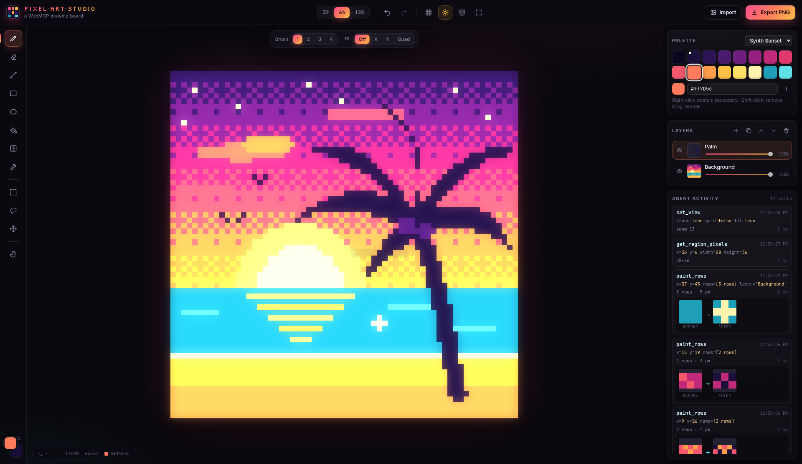

# Pixel Art Studio | WebMCP Imperative Demo

🚀 Live Demo: https://googlechromelabs.github.io/webmcp-tools/demos/pixel-art-studio/

A pixel-art drawing board built with TypeScript and Vite. Every drawing tool works for people (mouse and keyboard) and for AI agents through the **Imperative WebMCP API** (`document.modelContext.registerTool`). Agents compose scenes in SVG, which the studio turns into crisp, palette-matched pixel art. Every agent change animates onto the canvas with an agent cursor and shows up in an activity feed.



## 🚀 Getting Started

```bash
npm install
npm run dev
```

Open the local URL that Vite prints (`http://localhost:5173` by default) and connect a WebMCP agent, such as the [WebMCP extension](https://github.com/GoogleChromeLabs/webmcp-extension).

## 🛠️ How It Works

The demo registers 25 tools with `document.modelContext.registerTool`. People and agents share the same studio, so anything an agent paints can be undone, edited, or exported from the UI.

- **SVG for composition**: Models write SVG much better than they type pixel grids, so `draw_svg` (and `replace_selection` with `mode: "svg"`) takes SVG in canvas coordinates. The studio renders it with crisp edges, matches each color to the palette, and can add a 1-px outline.
- **A drawing workflow in the tools**: `get_canvas_info` tells agents to block in big shapes with `draw_svg`, add small details with `paint_rows`, then check the result with `get_region_pixels`.
- **Exporting stays with the user**: There is no export tool on purpose. Saving a file is the user's decision, made with the **Export PNG** button.
- **Errors the agent can act on**: Invalid SVG, missing coordinates, unknown option values, and similar problems come back as `{ ok: false, error }`, so the agent can fix its call.
- **Security**: Agent SVG is parsed without running scripts, and `<script>`, `<foreignObject>`, and `on*` attributes are removed before rendering. Agent text is HTML-escaped in the activity feed.
- **Official WebMCP types**: The tools use [`webmcp-types`](https://www.npmjs.com/package/webmcp-types), and each call gets the agent's cancel `signal`. If the agent cancels while an SVG is still rendering, nothing is painted.

## 📦 Registered Tools

Tools are defined in `src/webmcp/tools/` as plain objects in the WebMCP tool shape: `name`, `description`, `inputSchema`, `execute(input, { signal })`, and `annotations`.

### Canvas (`canvas.ts`)

| Tool Name                       | Description                                                                                                                                      | Parameters                                                   |
| :------------------------------ | :----------------------------------------------------------------------------------------------------------------------------------------------- | :----------------------------------------------------------- |
| `get_canvas_info` _(read-only)_ | Returns the canvas size, the palette (index, char, hex), the drawing colors, the layers, the selection, `svg_viewbox`, and the drawing workflow. | (none)                                                       |
| `set_canvas_size`               | Resizes the canvas and keeps the existing art.                                                                                                   | `size` (32, 64, 128) or `width` / `height` (8–256), `anchor` |
| `clear_canvas`                  | Clears every layer, one layer, or the selection.                                                                                                 | `scope` (all, layer, selection), `layer`, `reset_layers`     |
| `set_view`                      | Changes only the presentation: zoom, fit, grid, bloom glow, and CRT scanlines.                                                                   | `zoom`, `fit`, `grid`, `bloom`, `crt`                        |

### Palette & Colors (`palette.ts`)

| Tool Name     | Description                                                                           | Parameters                                                                  |
| :------------ | :------------------------------------------------------------------------------------ | :-------------------------------------------------------------------------- |
| `set_palette` | Loads a curated preset or a custom list of colors. Existing pixels are not recolored. | `preset` (sunset, pico8, endesga32, sweetie16, gameboy) or `colors`, `name` |
| `add_color`   | Adds a color to the palette and returns its index and paint char.                     | `color`                                                                     |
| `set_colors`  | Sets the primary and secondary drawing colors.                                        | `primary`, `secondary`                                                      |

### Drawing (`draw.ts`)

| Tool Name           | Description                                                                                                                                                                     | Parameters                                                                                                                |
| :------------------ | :------------------------------------------------------------------------------------------------------------------------------------------------------------------------------ | :------------------------------------------------------------------------------------------------------------------------ |
| `draw_svg`          | Draws shapes or a whole picture from SVG markup in canvas coordinates, with crisp edges, palette colors, and an optional 1-px outline. Returns the drawn `bounds` and `colors`. | `svg`, `region`, `outline`, `snap_to_palette`, `layer`                                                                    |
| `draw_pixels`       | Paints a batch of single pixels.                                                                                                                                                | `pixels` (`[{x, y, color?}]`), `color`, `layer`                                                                           |
| `draw_line`         | Draws a line between two points.                                                                                                                                                | `x0`, `y0`, `x1`, `y1`, `color`, `thickness` (1–8), `layer`                                                               |
| `draw_rect`         | Draws a filled (default) or outlined rectangle.                                                                                                                                 | `x`, `y`, `width`, `height`, `color`, `filled`, `layer`                                                                   |
| `draw_ellipse`      | Draws a filled (default) or outlined ellipse inside a bounding box.                                                                                                             | `x`, `y`, `width`, `height`, `color`, `filled`, `layer`                                                                   |
| `flood_fill`        | Bucket-fills the connected area of one color.                                                                                                                                   | `x`, `y`, `color`, `clip_to_selection`, `layer`                                                                           |
| `gradient_fill`     | Fills an area with a dithered gradient. Uses `region`, else the selection, else the whole canvas.                                                                               | `colors` (2 or more), `direction`, `angle`, `dither` (none, bayer2, bayer4, bayer8), `region`, `layer`                    |
| `draw_shape_preset` | Stamps a shape centered at a point.                                                                                                                                             | `shape` (heart, star, circle, diamond, sparkle, moon, sun, cloud), `x`, `y`, `size`, `color`, `color2`, `filled`, `layer` |
| `paint_rows`        | Paints small details or sprites, one string per row (see below). Warns when rows have different lengths.                                                                        | `rows`, `x`, `y`, `legend`, `clip_to_selection`, `animate`, `layer`                                                       |

### Selection (`selection.ts`)

| Tool Name                         | Description                                                                                                                                     | Parameters                                                                                                                                                                |
| :-------------------------------- | :---------------------------------------------------------------------------------------------------------------------------------------------- | :------------------------------------------------------------------------------------------------------------------------------------------------------------------------ |
| `get_selection` _(read-only)_     | Returns the selection the user drew: bounds, pixel count, and `mask_rows` for a lasso. Returns `null` when nothing is selected.                 | (none)                                                                                                                                                                    |
| `set_selection`                   | Selects a rectangle, a lasso polygon, or the whole canvas, or clears the selection.                                                             | `x`, `y`, `width`, `height`, `polygon`, `all`, `clear`                                                                                                                    |
| `replace_selection`               | Replaces what is inside the selection: SVG fitted into the selection, char rows, clear, fill, gradient, or noise. Never paints outside a lasso. | `mode` (svg, rows, clear, fill, gradient, noise), `svg`, `outline`, `snap_to_palette`, `rows`, `legend`, `color`, `colors`, `direction`, `dither`, `clear_first`, `layer` |
| `get_region_pixels` _(read-only)_ | Reads an area (by default the selection) as rows of palette chars plus a `legend`.                                                              | `x`, `y`, `width`, `height`, `source`, `layer`                                                                                                                            |

### Layers (`layers.ts`)

| Tool Name      | Description                                                                      | Parameters                                                      |
| :------------- | :------------------------------------------------------------------------------- | :-------------------------------------------------------------- |
| `add_layer`    | Adds an empty layer and makes it active.                                         | `name`, `position`                                              |
| `update_layer` | Renames, shows or hides, changes the opacity of, reorders, or activates a layer. | `layer`, `name`, `visible`, `opacity`, `move_to`, `make_active` |
| `delete_layer` | Deletes a layer. The last layer cannot be deleted.                               | `layer`                                                         |

### History (`history.ts`)

| Tool Name | Description                                                      | Parameters     |
| :-------- | :--------------------------------------------------------------- | :------------- |
| `undo`    | Undoes the last change or changes, made by a person or an agent. | `steps` (1–50) |
| `redo`    | Redoes undone changes.                                           | `steps` (1–50) |

### `paint_rows` format

```json
{ "x": 10, "y": 4, "rows": ["..44..", ".4bb4.", "4bbbb4"], "legend": { "P": "#ff77a8" } }
```

Each character is one pixel: a palette char (`0-9`, then `a-z`, `A-Z`, then `!#$%&*+-:;<=>?@^_`) or a char from `legend`. `.` or a space leaves a pixel unchanged, and `~` erases it. `get_region_pixels` uses the same encoding, so agents can read, edit, and write back.

## 🤖 Example Prompts

#### **Beach sunset**

> "Paint a beach sunset with a palm tree."

- **Trajectory** (the screenshot above): Agent calls `get_canvas_info` → `gradient_fill` for the sky → `draw_svg` for the clouds, sun, sea, and beach → `draw_pixels` for stars → `add_layer` and `draw_svg` for the palm tree → `paint_rows` for birds and a sparkle → `get_region_pixels` to check the result → `set_view` with `bloom: true`.

#### **Replace the selected area**

Drag a selection on the canvas, click **Regenerate with agent** in the selection bar, and ask:

> "Replace the selected area with a palm tree."

- **Trajectory**: Agent calls `get_selection` → `replace_selection` with `mode: "svg"`. The art stays inside the selection (even a lasso), and a before/after ghost is shown.

#### **Set up a bigger canvas**

> "Make the canvas 128 by 128, show the pixel grid, and draw a pink heart in the middle."

- **Trajectory**: Agent calls `set_canvas_size` with `size: 128` → `set_view` with `grid: true` → `draw_shape_preset` with `shape: "heart"`.

## ✨ Features

- **Drawing tools**: Pencil (B), Eraser (E), Line (L), Rectangle (R), Ellipse (O), Flood fill (G), Dither gradient (D), and Eyedropper (I, or hold Alt). Shift constrains shapes, and U toggles filled/outline.
- **Selections**: Rect select (M), Lasso (Q), and Move selection (V). The selection bar can Clear, Fill, apply a Gradient, Move, or **Regenerate with agent**, which marks the selection for the agent and copies a prompt starter.
- **Canvas & view**: Mirror symmetry (X, Y, Quad), brush sizes 1–4 (`[` `]`), canvas sizes 32/64/128, grid (`#`), bloom glow, CRT scanlines, fit (F), wheel zoom, and pan (H, Space, or middle mouse).
- **Layers & history**: Add, duplicate, reorder, hide, set opacity, and double-click to rename. Undo and redo with Ctrl+Z / Ctrl+Shift+Z.
- **Palettes**: Synth Sunset, PICO-8, Endesga 32, Sweetie 16, and Game Boy, with a palette editor.
- **Import & export**: Import an image to pixelate it to the palette, and export a PNG at 1–32×.

## 🧪 Testing

- **Lint and format** (checked in CI): `npm run lint` and `npm run format`.
- **WebMCP smoke test** (runs in CI): with the dev server running, run every case in [`webmcp-evals/examples/pixel-art-studio/evals.json`](../../webmcp-evals/examples/pixel-art-studio/evals.json) from the `webmcp-evals/` folder:
  ```bash
  URL=http://localhost:5173 ./run_smoke.sh pixel-art-studio -v
  ```
- **End-to-end script**: with the dev server running, `node scripts/smoke.mjs` connects to a Chrome debugging endpoint on `127.0.0.1:9222`, opens the demo (`URL`, default `http://localhost:5173`), calls every tool through `document.modelContext`, and saves screenshots to `test-results/`, which git ignores. It also checks that a cancelled call paints nothing and that a mouse-drawn selection is visible to agents. It prints `PASS: 25/25 tools ok`.

## 📂 Project Structure

```
src/
  main.ts            UI shell: DOM, input handling, palette/layer panels, activity feed
  model.ts           Studio document: layers, history, rasterizers, Bayer dither, selection
  view.ts            Canvas2D renderer: zoom/pan, bloom, materialize FX, onion, agent cursor
  palettes.ts        Curated palettes
  webmcp/
    index.ts         buildTools(ctx): assembles all tool groups
    types.ts         ToolContext, ToolSpec, feed types (WebMCP types come from webmcp-types)
    schema.ts        Shared JSON Schema fragments + requireInts
    helpers.ts       Layer lookup, painting, paint_rows decoding, state snapshots
    shapes.ts        Procedural shapes for draw_shape_preset
    svg.ts           SVG → pixels for draw_svg: sanitizing, crisp rendering, palette match, outline
    runtime.ts       Feedback wrapper (feed, animation) + feature-detected registration
    tools/           canvas, palette, draw, selection, layers, history
scripts/
  smoke.mjs          End-to-end test of every tool via document.modelContext
  shot.mjs           Diagnostics + screenshot
docs/screenshots/    README screenshot
```

---

_Note: This is an educational demo of the WebMCP standard. It has no backend and stores nothing. WebMCP is an experimental API that may change._
