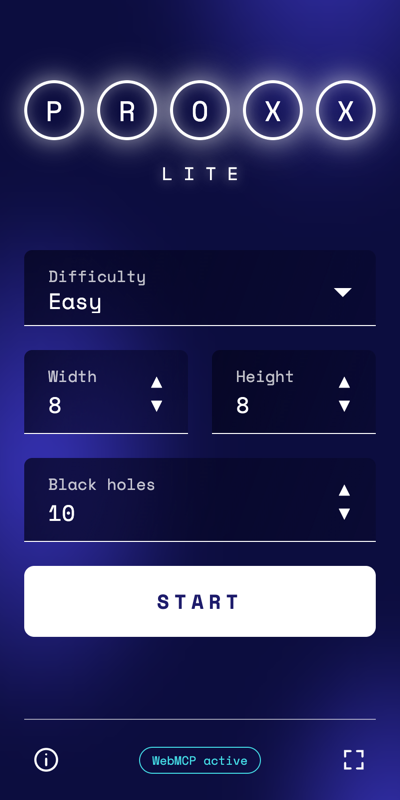
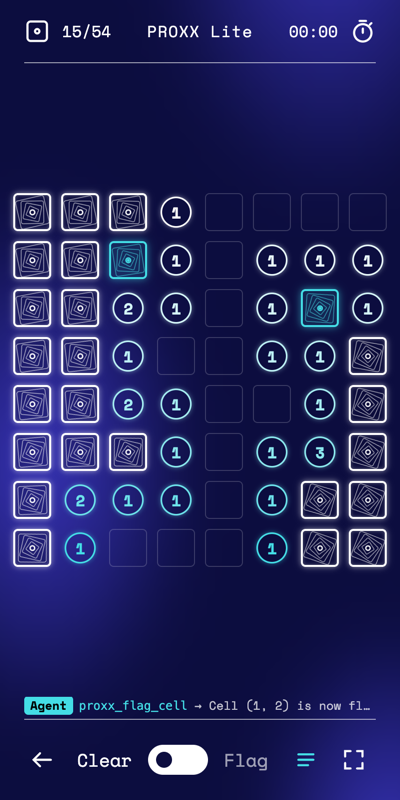

# PROXX Lite | WebMCP Imperative Demo

🚀 Live Demo: https://googlechromelabs.github.io/webmcp-tools/demos/proxx-lite/

A simplified take on [PROXX](https://github.com/GoogleChromeLabs/proxx), built with Vue 3 and Vite. It is inspired by the original game but is not the same: there is no WebAssembly engine, no offline support, and no multiplayer. People and AI agents clear the same board of black holes. Agents play through the **Imperative WebMCP API** (`document.modelContext.registerTool`), and every tool call shows up in the game.

| Home                                     | Game                                     |
| :--------------------------------------- | :--------------------------------------- |
|  |  |

To try this demo, check the [requirements](../README.md#requirements).

## 🚀 Getting Started

```bash
npm ci
npm run dev
```

Open the local URL that Vite prints (`http://localhost:5173` by default) and connect a WebMCP agent, such as the [WebMCP extension](https://github.com/GoogleChromeLabs/webmcp-extension).

## 🛠️ How It Works

- **Registration**: Tools are registered with VueUse's [`useWebMCP`](https://vueuse.org/core/useWebMCP/), which feature-detects `document.modelContext` and unregisters each tool through an `AbortSignal` when the component unmounts.
- **Shared state**: The UI and the tools call the same game functions in `src/game.ts`. A tool returns only after Vue has rendered the move, so the agent and the user always see the same board.
- **Board as text**: Every tool response includes a text grid of the board (`#` hidden, `F` flagged, `.` empty, `1`–`8` clues), so agents can reason about it without a screenshot.
- **Errors the agent can act on**: Out-of-bounds cells, non-integer coordinates, and impossible board sizes come back as `{ ok: false, message }` with a hint on how to fix the call.
- **Agent activity**: The latest tool call shows above the bottom bar, and the full log opens from the bottom bar.

## 📦 Registered Tools

| Tool Name                       | Description                                                                                            | Parameters                                                 |
| :------------------------------ | :----------------------------------------------------------------------------------------------------- | :--------------------------------------------------------- |
| `proxx_get_state` _(read-only)_ | Returns the game status, board size, black hole and flag counts, and a text grid of the board.         | (none)                                                     |
| `proxx_new_game`                | Starts a new game from a preset or with custom dimensions.                                             | `difficulty` (easy, medium, hard), `rows`, `cols`, `blackHoles` |
| `proxx_reveal_cell`             | Reveals a hidden cell. The first reveal is always safe; revealing a black hole ends the game.         | `row`, `col`                                               |
| `proxx_flag_cell`               | Places, removes, or toggles a flag on a hidden cell.                                                   | `row`, `col`, `flagged`                                    |
| `proxx_chord_cell`              | On a revealed number whose flag count matches, reveals all its other hidden neighbors.                 | `row`, `col`                                               |

## 🎮 Playing

- **Presets**: Easy (8×8, 10 black holes), Medium (16×16, 40), and Hard (24×24, 99), or any custom size up to 40×30.
- **Clear / Flag**: Use the switch in the bottom bar, or right-click to flag. Tap a revealed number to clear its neighbors when its flags match.
- **Best times**: Your best time for each board size is saved in `localStorage`.

## 🧪 Testing

- **WebMCP smoke test** (runs in CI): with the dev server running, run every case in [`webmcp-evals/examples/proxx-lite/evals.json`](../../webmcp-evals/examples/proxx-lite/evals.json) from the `webmcp-evals/` folder:
  ```bash
  URL=http://localhost:5173 ./run_smoke.sh proxx-lite -v
  ```
- **Tool script**: `node scripts/smoke-test.mjs` mocks `document.modelContext`, loads the tools through Vite, and plays a game through the tools with a simple solver. It needs no browser.

## 📂 Project Structure

```
src/
  App.vue        UI: home, game, win/lose screens, how-to-play and agent log dialogs
  game.ts        Game state and rules: reveal, flag, chord, board as text, test solver
  webmcp.ts      WebMCP tool definitions and registration (useProxxTools)
  main.ts        App entry point
scripts/
  smoke-test.mjs Tool test with a mocked document.modelContext
docs/screenshots/ README screenshots
```

---

_Note: This is an educational demo of the WebMCP standard. It is not affiliated with the original PROXX game. It has no backend and only stores best times in your browser. WebMCP is an experimental API that may change._
