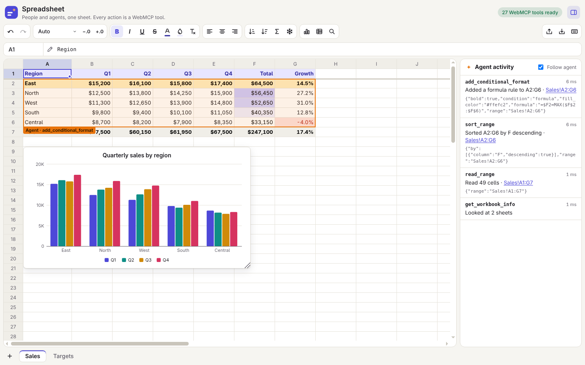

# Spreadsheet | WebMCP Imperative Demo

🚀 Live Demo: https://googlechromelabs.github.io/webmcp-tools/demos/spreadsheet/

A full spreadsheet with formulas, formatting, charts and sheets, built with TypeScript and Vite and no runtime dependencies. People use it with the mouse and keyboard. AI agents use the same features through 27 tools registered with the **Imperative WebMCP API** (`document.modelContext.registerTool`). Each agent change is one undo step, shows up in the activity panel, and lights up the cells it touched.



To try this demo, check the [requirements](../README.md#requirements).

## 🚀 Getting Started

```bash
npm install
npm run dev
```

## 🛠️ How It Works

- **One workbook for people and agents**: The tools call the same workbook code as the toolbar, menus and keyboard. People and agents share one undo history, so either can undo the other's change.
- **Agents type like people**: `set_values` takes what a person would type, like `$1,200`, `12%`, `2026-10-13` or `=SUM(B2:B9)`, and returns the computed values and any formula errors.
- **A1 references everywhere**: Tools take ranges like `B2:D9`, `Sales!A:C` or `'Q1 Sales'!B2`. Without a sheet name, a range means the sheet on screen.
- **Types from the schema**: `defineTool()` infers each tool's input type from its JSON Schema with [`webmcp-types`](https://www.npmjs.com/package/webmcp-types) (`ModelContextToolFromSchema`). The same schema is checked at run time (types, enum values, ranges, required and unknown parameters), and schema `default` values are filled in, so the types hold.
- **Errors the agent can act on**: A refused call returns `{ error }` with details, such as the names of the existing sheets, and changes nothing. Calls that would change nothing, like `format_cells` without a format, are refused too.
- **Formulas**: 102 functions, including `SUMIFS`, `XLOOKUP`, `VLOOKUP`, `INDEX`/`MATCH`, `TEXT`, `PMT` and date functions. References follow inserted and deleted rows and columns, moved cells and renamed sheets. Circular references show an error instead of hanging.
- **The platform does the UI work**: an ARIA `grid` that skips off-screen rows with `content-visibility`, popover menus placed with anchor positioning, `<dialog>` with invoker commands, `light-dark()` theming, and `contrast-color()` to keep text readable on any fill color.

## 📦 Registered Tools

Tools are defined in `src/webmcp/tools/` with `defineTool()`: `name`, `description`, `inputSchema`, `execute(input)` and `annotations`. Tools run synchronously, so a call can't be cancelled partway through. The four read tools set `readOnlyHint`. Every tool except `undo_spreadsheet_action` and `redo_spreadsheet_action` sets `untrustedContentHint`, because its result can hold text that people typed, pasted or imported: cell values, chart titles, rule criteria, or at least a sheet name. Reads stay within about 1,500 characters: long results come back a page at a time, with `truncated: true` and where to continue (`next_range`, or `next_start` for `find_cells`).

### Reading (`read.ts`)

| Tool Name                                 | Description                                                                                                               | Parameters                                                                |
| :---------------------------------------- | :------------------------------------------------------------------------------------------------------------------------ | :------------------------------------------------------------------------ |
| `get_workbook_info` _(read-only)_         | Lists every sheet with its used range, size, frozen rows and columns, charts and conditional formats, plus the selection. | (none)                                                                    |
| `get_spreadsheet_selection` _(read-only)_ | Returns the cells the person selected, with values, formulas, count, sum and average.                                     | (none)                                                                    |
| `read_range` _(read-only)_                | Reads values, formulas and formula errors, a page at a time. Empty rows and columns after the data are left out.          | `range`, `include_formats`                                                |
| `find_cells` _(read-only)_                | Finds cells that contain some text, on one sheet or all of them, a page at a time, with the total count.                  | `query`, `sheet`, `match_case`, `entire_cell`, `search_formulas`, `start` |

### Cells (`cells.ts`)

| Tool Name      | Description                                                                           | Parameters                                                                     |
| :------------- | :------------------------------------------------------------------------------------ | :----------------------------------------------------------------------------- |
| `set_values`   | Types values and formulas into cells. One value with a larger range fills every cell. | `range`, `values`                                                              |
| `clear_range`  | Clears contents, formatting, or both.                                                 | `range`, `what` (contents, formats, all)                                       |
| `autofill`     | Continues a pattern like the fill handle: 1, 2 → 3, 4; Jan → Feb; formulas adjust.    | `source`, `target`                                                             |
| `copy_range`   | Copies or moves cells. Moved cells keep the formulas that refer to them working.      | `source`, `destination`, `paste` (all, values, formats, formulas), `move`      |
| `replace_text` | Replaces text in values, and optionally in formulas.                                  | `find`, `replacement`, `range`, `match_case`, `entire_cell`, `search_formulas` |
| `sort_range`   | Sorts rows by one to three columns. Blank cells go last.                              | `range`, `by` (`[{column, descending}]`), `has_header`                         |
| `select_range` | Selects cells for the person and scrolls to them.                                     | `range`                                                                        |

### Rows, columns and sheets (`structure.ts`, `sheets.ts`)

| Tool Name        | Description                                                  | Parameters                                                   |
| :--------------- | :----------------------------------------------------------- | :----------------------------------------------------------- |
| `insert_rows`    | Inserts empty rows above a row.                              | `row`, `count`, `sheet`                                      |
| `insert_columns` | Inserts empty columns left of a column.                      | `column`, `count`, `sheet`                                   |
| `delete_rows`    | Deletes rows. References to deleted cells become `#REF!`.    | `row`, `count`, `sheet`                                      |
| `delete_columns` | Deletes columns. References to deleted cells become `#REF!`. | `column`, `count`, `sheet`                                   |
| `resize_columns` | Sets column widths, or fits them to their content.           | `columns`, `width` or `fit_to_content`                       |
| `add_sheet`      | Adds an empty sheet.                                         | `name`, `position`                                           |
| `update_sheet`   | Renames a sheet, moves its tab, or freezes rows and columns. | `sheet`, `name`, `position`, `frozen_rows`, `frozen_columns` |
| `delete_sheet`   | Deletes a sheet. Undo brings it back.                        | `sheet`                                                      |

### Formatting (`format.ts`)

| Tool Name                   | Description                                                         | Parameters                                                                                                                                  |
| :-------------------------- | :------------------------------------------------------------------ | :------------------------------------------------------------------------------------------------------------------------------------------ |
| `format_cells`              | Changes only the formats you pass.                                  | `range`, `bold`, `italic`, `underline`, `strikethrough`, `text_color`, `fill_color`, `align`, `number_format`, `decimals`, `currency`       |
| `add_conditional_format`    | Styles cells by their values, or shades numbers with a color scale. | `range`, `condition`, `value`, `value2`, `formula`, `text_color`, `fill_color`, `bold`, `italic`, `strikethrough`, `min_color`, `max_color` |
| `delete_conditional_format` | Removes a rule by id, or every rule on a range.                     | `id` or `range`                                                                                                                             |

### Charts and history (`charts.ts`, `history.ts`)

| Tool Name                 | Description                                                                                      | Parameters                                                                                  |
| :------------------------ | :----------------------------------------------------------------------------------------------- | :------------------------------------------------------------------------------------------ |
| `add_chart`               | Adds a column, bar, line, area, pie or scatter chart. Finds the header row and labels by itself. | `range`, `type`, `title`, `position`, `width`, `height`, `header_row`, `label_column`       |
| `update_chart`            | Changes a chart's type, title, data, position or size.                                           | `id`, `type`, `title`, `range`, `position`, `width`, `height`, `header_row`, `label_column` |
| `delete_chart`            | Deletes a chart. Its data stays.                                                                 | `id`                                                                                        |
| `undo_spreadsheet_action` | Undoes the latest changes, made by a person or an agent.                                         | `steps` (1–20)                                                                              |
| `redo_spreadsheet_action` | Redoes undone changes.                                                                           | `steps` (1–20)                                                                              |

## 🤖 Example Prompts

#### **Build a budget**

> "Build a monthly budget for a family of four with totals and a chart."

- **Trajectory**: Agent calls `set_values` with the categories, amounts and `=SUM()` totals → `format_cells` for the header and the currency columns → `add_chart`.

#### **Work with the selection**

Select some cells, then ask:

> "What is the average of these cells? Make the biggest one bold."

- **Trajectory**: Agent calls `get_spreadsheet_selection` → `format_cells` on the cell with the largest value.

#### **Clean up the sample data**

Click **Load sample sales data**, then ask:

> "Highlight regions with negative growth in red, sort the table by total, highest first, and freeze the header row."

- **Trajectory**: Agent calls `get_workbook_info` → `read_range` → `add_conditional_format` with `condition: "less_than"` → `sort_range` with `has_header: true` → `update_sheet` with `frozen_rows: 1`.

## ✨ Features

- **Editing**: Type in a cell or the formula bar, with function suggestions and colored boxes on the cells a formula uses. Click cells while typing a formula to insert their references.
- **Keyboard**: Arrows, Ctrl+arrows, Shift to extend, Tab and Enter, F2, Ctrl+Z / Ctrl+Y, Ctrl+B / I / U, Ctrl+D / Ctrl+R to fill, Alt+= to sum, and Shift+F10 for the cell menu. The keyboard button lists them all.
- **Cells**: Copy, cut and paste within the workbook and with other spreadsheets, paste values only, the fill handle, sort, find and replace, and column resizing (double-click to fit).
- **Formats**: Currency, percent, number, date and time formats, decimals, bold, italic, underline, strikethrough, colors, alignment and conditional formatting.
- **Sheets**: Add, rename, reorder and delete sheets, freeze rows and columns, and import or export CSV.
- **Agent activity**: Every tool call shows its input, result and time. With **Follow agent** on, the sheet follows the agent's changes.

## 🧪 Testing

- **Lint and format** (checked in CI): `npm run lint` and `npx oxfmt --check`.
- **Unit tests** (run in CI before the build): `npm test` runs the formula engine, workbook and tool tests with Node's test runner.
- **WebMCP smoke test** (runs in CI): with the dev server running, run every case in [`webmcp-evals/examples/spreadsheet/evals.json`](../../webmcp-evals/examples/spreadsheet/evals.json) from the `webmcp-evals/` folder:
  ```bash
  URL=http://localhost:5173 ./run_smoke.sh spreadsheet -v
  ```
- **End-to-end script**: with the dev server running, `node scripts/smoke.mjs` starts Chrome with WebMCP, calls all 27 tools through `document.modelContext.executeTool()`, checks their results, checks that a formula a person types is visible to agents, and saves a screenshot to `test-results/`, which git ignores. Set `URL` if Vite uses another port. It prints `PASS: 27/27 tools ok`.

## 📂 Project Structure

```
src/
  main.ts            Starts the app and registers the tools
  sample.ts          Sample sales data
  engine/            Formula engine: A1 references, parser, evaluator, functions, number formats
  model/             Workbook: sheets, edits, undo history, recalculation, charts, conditional formats
  ui/                Grid, cell editor, toolbar, menus, dialogs, charts, sheet tabs, activity panel
  webmcp/
    index.ts         buildTools(): all tool groups
    runtime.ts       defineTool(), the wrapper (checks, undo step, activity panel) and registration
    schema.ts        JSON Schema helpers and the input checker
    refs.ts          Reading A1 references, colors and columns; describing cells in results
    tools/           read, cells, structure, format, sheets, charts, history
scripts/
  smoke.mjs          End-to-end test of every tool via document.modelContext
docs/screenshots/    README screenshot
```

---

_Note: This is an educational demo of the WebMCP standard. It has no backend and stores nothing. WebMCP is an experimental API that may change._
